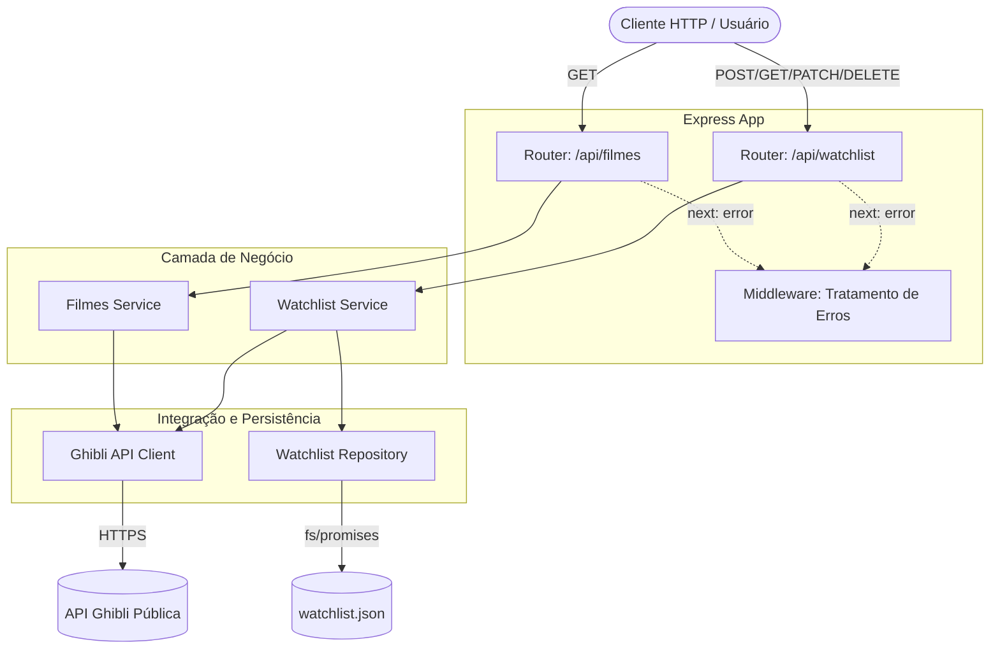

# Documento de Arquitetura: Ghibli Tracker

Este documento descreve a arquitetura da API do Ghibli Tracker, seus principais componentes, fluxos de dados e as decisões arquiteturais tomadas durante o desenvolvimento.

## 1. Padrão Arquitetural

A aplicação segue o padrão de **Arquitetura em Camadas (Layered Architecture)**, desenhada para separar responsabilidades, facilitar a testabilidade (mocking) e permitir a evolução independente das partes do sistema.

As camadas são:

- **Routes (Rotas):** Recebem as requisições HTTP, extraem os parâmetros/corpo e repassam para os serviços.
- **Services (Serviços):** Contêm a inteligência e as regras de negócio (validações, cálculos de estatísticas).
- **Repositories (Repositórios):** Abstraem o acesso ao banco de dados local (JSON).
- **Clients (Clientes):** Abstraem a comunicação com APIs externas (Studio Ghibli API).

## 2. Diagrama de Componentes

Abaixo está o diagrama ilustrando a comunicação entre os módulos internos do sistema e o mundo externo:

## 3. Fluxos Principais

### A. Fluxo de Busca de Filmes

1. O cliente faz um `GET /api/filmes?titulo=X`.
2. A rota repassa a requisição ao `filmesService`.
3. O serviço invoca o `ghibliClient`, que faz uma requisição HTTPS para a API externa.
4. O cliente mapeia os campos do inglês para o português e filtra os resultados pelo título.
5. Os dados processados retornam ao usuário.

### B. Fluxo de Adição à Watchlist

1. O cliente faz um `POST /api/watchlist` enviando um `filmeId`.
2. O `watchlistService` valida o ID e consulta o `watchlistRepository` para checar se o filme já existe (Regra RN02).
3. Se não existir, o serviço busca os dados originais do filme no `ghibliClient`.
4. Um novo objeto local é criado (snapshot) contendo o título, diretor, ano, e campos locais (`assistido`, `nota`).
5. O `watchlistRepository` grava atomicamente a nova lista no arquivo JSON.

### C. Fluxo de Estatísticas

1. O cliente faz um `GET /api/watchlist/estatisticas`.
2. O `watchlistService` pede todos os registros ao `watchlistRepository`.
3. O serviço itera sobre a lista na memória (usando `.filter` e `.reduce`) para calcular o total de filmes, total assistido e a nota média.
4. O objeto agregado é devolvido ao usuário.

## 4. Registro de Decisões Arquiteturais (ADRs)

### ADR 01: Persistência em JSON Local vs. Banco de Dados

- **Contexto:** A aplicação precisa persistir a watchlist do usuário. Havia a opção de integrar um banco de dados relacional (PostgreSQL/SQLite) ou NoSQL (MongoDB).
- **Decisão:** Optou-se por utilizar o File System nativo do Node.js (`fs/promises`) para gravar um arquivo `watchlist.json` localmente.
- **Justificativa:**
  1. **Portabilidade (RNF04):** O sistema deve rodar apenas com o Node.js instalado, sem exigir containers Docker ou setup de bancos de dados locais por parte do avaliador.
  2. **Escopo Acadêmico:** O volume de dados esperado para um usuário único (dezenas a centenas de filmes) não justifica o overhead computacional de um SGBD.
- **Mitigação de Riscos:** Para evitar a corrupção do arquivo JSON em caso de queda do servidor durante a escrita, implementou-se **escrita atômica** (gravando primeiro em um arquivo `.tmp` e renomeando em seguida).
