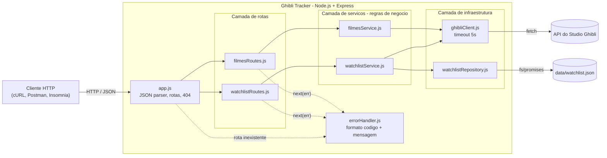
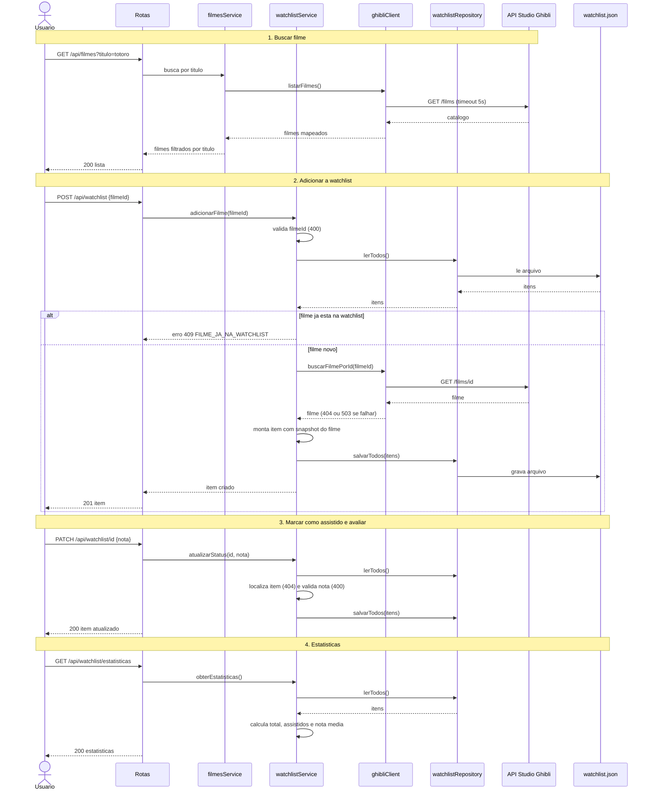

# Arquitetura: Ghibli Tracker

Este documento descreve como o Ghibli Tracker está organizado, como os componentes se relacionam e por que as principais decisões foram tomadas. Ele vale para a versão 1.x da API e deve ser atualizado sempre que uma camada, um fluxo ou uma decisão mudar (ver regra de sincronização em [`docs/README.md`](README.md)).

## 1. Visão geral

O Ghibli Tracker é uma API REST em **Node.js 18+ com Express**. Ela faz duas coisas:

1. **Consulta** o catálogo de filmes na API pública do Studio Ghibli (somente leitura).
2. **Mantém uma watchlist local**, persistida em `data/watchlist.json`, com status de assistido e nota.

Não há banco de dados, autenticação nem front-end. A aplicação é monousuário.

## 2. Camadas e responsabilidades

| Camada             | Pasta / arquivos                                                    | Responsabilidade                                                                                                                                                                       | Pode depender de    |
| ------------------ | ------------------------------------------------------------------- | -------------------------------------------------------------------------------------------------------------------------------------------------------------------------------------- | ------------------- |
| **Entrada**        | `src/server.js`, `src/app.js`                                       | `server.js` apenas inicia o HTTP. `app.js` monta o Express (`express.json()`, `GET /api/health`, rotas, 404 e `errorHandler`) sem chamar `listen`, o que permite testar com Supertest. | Rotas, middleware   |
| **Rotas**          | `src/routes/filmesRoutes.js`, `src/routes/watchlistRoutes.js`       | Ler parâmetros, corpo e query da requisição, delegar ao serviço e devolver o status HTTP. Não contêm regra de negócio. Qualquer exceção vai para `next(error)`.                        | Serviços            |
| **Serviços**       | `src/services/filmesService.js`, `src/services/watchlistService.js` | Regras de negócio e validações: duplicidade, snapshot do filme, nota, estatísticas. Lançam erros de domínio com `status` e `codigo`.                                                   | Client, repositório |
| **Infraestrutura** | `src/clients/ghibliClient.js`                                       | Único ponto de acesso à API do Studio Ghibli: `fetch`, timeout de 5 s e tradução de falhas em erros de domínio (404 e 503).                                                            | API externa         |
|                    | `src/repositories/watchlistRepository.js`                           | Único ponto de acesso ao arquivo JSON: `lerTodos()` e `salvarTodos(itens)`.                                                                                                            | Sistema de arquivos |
| **Transversal**    | `src/middlewares/errorHandler.js`                                   | Converte qualquer erro em JSON padronizado `{ codigo, mensagem }`.                                                                                                                     | -                   |

**Regra de dependência:** a seta só aponta para baixo (rotas → serviços → client/repositório). Nenhuma camada importa uma camada acima dela. Isso permite substituir o repositório JSON por um banco sem tocar nas rotas.

**Dependências e testes:** os módulos são ligados por `require`. Nos testes, o client e o repositório são substituídos com `jest.mock` ou arquivos temporários, então nenhum teste acessa a rede real. Injeção de dependência explícita (passar client e repositório por parâmetro) é uma evolução possível, mas não foi necessária neste escopo.

## 3. Diagrama de componentes



## 4. Fluxo: busca → watchlist → estatísticas



**Observações sobre o fluxo:**

- No `POST`, a verificação de duplicidade acontece **antes** de consultar a API externa. Um filme repetido é rejeitado sem gastar uma chamada externa.
- `GET /api/watchlist` e `GET /api/watchlist/estatisticas` leem somente o arquivo local e funcionam mesmo com a API do Studio Ghibli fora do ar (snapshot).
- A rota `GET /api/watchlist/estatisticas` é declarada **antes** de qualquer rota com parâmetro `/:id`. Hoje só existem `PATCH /:id` e `DELETE /:id`, então não há conflito. Se uma futura `GET /:id` for criada, ela deve ficar **depois**, senão `estatisticas` seria lido como um `id`.

## 5. Modelo de dados

Cada item da watchlist é um objeto em um array JSON:

| Campo           | Tipo              | Descrição                                                       |
| --------------- | ----------------- | --------------------------------------------------------------- |
| `id`            | string (UUID)     | Identificador local, gerado com `crypto.randomUUID()`           |
| `filmeId`       | string            | ID do filme na API do Studio Ghibli (chave de duplicidade)      |
| `titulo`        | string            | Cópia do título no momento da adição                            |
| `diretor`       | string            | Cópia do diretor                                                |
| `anoLancamento` | string            | Cópia do ano de lançamento, conforme devolvido pela API externa |
| `assistido`     | boolean           | `false` ao adicionar. Passa a `true` no `PATCH`                 |
| `nota`          | number ou `null`  | `null` até ser avaliado. Valor entre 1 e 5                      |
| `adicionadoEm`  | string (ISO 8601) | Data de criação                                                 |
| `atualizadoEm`  | string (ISO 8601) | Data da última alteração                                        |

```json
[
  {
    "id": "5f0a9c52-1d0e-4a3b-9c0e-6b8a3f2d7e11",
    "filmeId": "58611129-2dbc-4a81-a72f-77ddfc1b1b49",
    "titulo": "My Neighbor Totoro",
    "diretor": "Hayao Miyazaki",
    "anoLancamento": "1988",
    "assistido": true,
    "nota": 5,
    "adicionadoEm": "2026-11-06T19:10:00.000Z",
    "atualizadoEm": "2026-11-06T20:02:00.000Z"
  }
]
```

## 6. Tratamento de erros

Todo erro de domínio é um `Error` com as propriedades `status` (HTTP), `codigo` (identificador estável) e `message`. As rotas encaminham tudo com `next(error)`, e o `errorHandler` responde:

```json
{
  "codigo": "ITEM_NAO_ENCONTRADO",
  "mensagem": "O item não foi encontrado na watchlist."
}
```

- Erros de domínio (os que carregam `codigo`) devolvem a mensagem definida na origem (`err.mensagem` ou, na falta, `err.message`).
- Erros sem `codigo` são inesperados: viram **500** com `ERRO_INTERNO_SERVIDOR`, mensagem genérica e registro com `console.error` no servidor. Stack trace e detalhes internos **nunca** são enviados ao cliente (RNF05).
- JSON malformado no corpo vira **400** com `JSON_MALFORMADO`.
- Rotas inexistentes viram **404** com `ROTA_NAO_ENCONTRADA`.
- O servidor não encerra por erro de requisição. Todo caminho passa pelo `errorHandler`.

## 7. Decisões arquiteturais (ADR)

### ADR-001: Persistência em arquivo JSON local em vez de banco de dados

- **Contexto:** o escopo é monousuário, de uma semana, e o foco da disciplina é especificação e fluxo de engenharia, não administração de banco.
- **Decisão:** persistir a watchlist em `data/watchlist.json`, acessado somente por `watchlistRepository`.
- **Alternativas consideradas:** SQLite, MongoDB e PostgreSQL (exigem serviço externo e contrariam a portabilidade, RNF04).
- **Consequências positivas:** zero infraestrutura, instalação com `npm install`, dados legíveis a olho nu e testes simples com arquivo temporário.
- **Consequências negativas:** sem controle de concorrência. Duas escritas simultâneas podem perder uma delas. É aceitável para uso monousuário, mas é o primeiro limite a atacar se o projeto crescer.
- **Reversibilidade:** alta. Como só o repositório conhece o arquivo, trocar por um banco exige reescrever apenas `watchlistRepository.js`.

### ADR-002: Arquitetura em camadas, com `app.js` separado de `server.js`

- **Contexto:** é preciso testar rotas sem abrir porta e isolar regras de negócio da infraestrutura.
- **Decisão:** camadas rotas → serviços → client/repositório, e `app.js` exporta o Express sem chamar `listen`.
- **Consequências:** Supertest importa `app` diretamente, e cada camada tem testes próprios.

### ADR-003: Snapshot do filme na watchlist

- **Contexto:** listar a watchlist não deveria depender da disponibilidade da API externa.
- **Decisão:** ao adicionar, copiar `titulo`, `diretor` e `anoLancamento` para o item.
- **Consequências:** listagem e estatísticas funcionam offline. Em contrapartida, se a API externa corrigir um título, a cópia local não muda.

### ADR-004: Erros de domínio como `Error` com `status` e `codigo`

- **Contexto:** o `errorHandler` precisa saber qual status e qual código devolver sem acoplar os serviços ao Express.
- **Decisão:** os serviços criam `Error` e anexam `status` e `codigo`. O `errorHandler` centralizado traduz para JSON.
- **Consequências:** serviços ficam independentes de HTTP e o formato de erro é único.

## 8. Comportamento implementado das regras de negócio

| Regra        | Comportamento na versão 1.x                                                              | Onde                                 |
| ------------ | ---------------------------------------------------------------------------------------- | ------------------------------------ |
| Duplicidade  | O mesmo `filmeId` não pode ser adicionado duas vezes (409 `FILME_JA_NA_WATCHLIST`)       | `watchlistService.adicionarFilme`    |
| Snapshot     | `titulo`, `diretor` e `anoLancamento` são copiados na adição                             | `watchlistService.adicionarFilme`    |
| Assistido    | `PATCH /api/watchlist/:id` sempre define `assistido = true`                              | `watchlistService.atualizarStatus`   |
| Nota         | Opcional no `PATCH`. Se enviada, deve ser número entre 1 e 5 (400 `NOTA_INVALIDA`)       | `watchlistService.atualizarStatus`   |
| Remoção      | `DELETE /api/watchlist/:id` remove o item (204) ou responde 404                          | `watchlistService.removerFilme`      |
| Estatísticas | `totalFilmes`, `totalAssistidos` e `notaMedia` (1 casa decimal, `0` se não houver notas) | `watchlistService.obterEstatisticas` |

## 9. Limitações conhecidas

- Não existe operação para **desmarcar** um filme como assistido.
- A nota aceita **valores decimais** entre 1 e 5. Não é restrita a inteiros.
- Um `PATCH` sem `nota` marca o item como assistido sem avaliá-lo.
- Não há paginação, ordenação ou filtro na listagem da watchlist.
- Não há controle de concorrência (ver ADR-001).
- Não há cache do catálogo: cada busca consulta a API externa.
